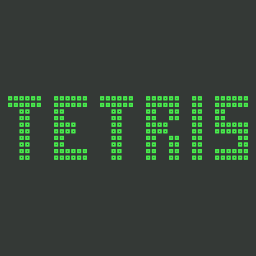

TETRIS 1984
=====================
The very first Tetris, Elektronika 60, 1984, reconstructed for modern web browsers.

## About
Tetris was written in 1984 by Alexey Pajitnov (Алексей Пажитнов) at the
Computing Centre of the Academy of Sciences of the USSR (Вычислительный
центр АН СССР), in Pascal under RT-11 on the Soviet Elektronika 60
(Электроника-60), a clone of the DEC PDP-11 driving a text terminal. This is
a historically faithful reconstruction of that **first version** — not an
emulator or a binary copy, and not one of the later versions (IBM PC, ZX
Spectrum, NES, Game Boy …).

The goal is not the best Tetris but the most faithful one: no colours, no
modern mechanics (no wall kicks, hold, ghost piece or 7-bag), and
documentation that separates what the original program proves from what had
to be assumed.

The game program of the surviving RT-11 binary `TET.SAV` is converted
routine for routine (`app/tetrisLogic.js`, its variables at the original's
addresses) and runs in the worker under a model of RT-11's terminal handler
(`app/rt11Host.js`). It draws on the `terminal` platform of svision as the
15IE-00-013 (15ИЭ-00-013) terminal, a Soviet clone of the DEC VT52, with the
terminal's own character set. `tools/matchgame.mjs` finds 0 differences
against 11 whole games of the original, variables and terminal output byte
for byte. The timing is a placeholder until milestone M3. The only sound, as
in the original, is the terminal's BEL on a level up and at the end of a game.

Supported:
- keyboard (redefinable keys for the four moves)
- gamepad
- PWA application


## Status
An unofficial, non-commercial reconstruction, made public so that the author
can judge its fidelity. Tetris is a trademark of The Tetris Company; the
rights are held by Tetris Holding, LLC.


## Menu
The menu is the remake's — the original is a program started from the RT-11
prompt. It is drawn in the terminal's own characters: the TETRIS logo made of
the game's cells, **PLAY TET** (the older revision, cells of two DEL
characters, a solid block on the Soviet terminal), **PLAY TETRIS** (the later
one, cells `[]`), PLAYER NAME, HALL OF FAME, SOUNDS, SETTINGS and ABOUT. A
game starts the way it did:
RT-11's prompt and `RUN DL1:TET` or `RUN DL1:TETRIS` typed at it; when the
program ends (НЕТ to ЕЩЕ ПАРТИЮ?) the terminal goes back to the menu. Escape
pauses.

The original asks for a name at the end of a game; the remake does not. The
name is PLAYER NAME of the menu, in Latin as typed, and the program writes
it into its own table of results between SI and SO, so it stays Latin in a
table printed in Cyrillic mode (a reconstruction choice, off in the match
tools). Before the table is shown the worker asks the server for the latest
best 20, so other players' games are in it too. HALL OF FAME shows the best
20 games of the database.


## Controls
| key | action |
|---|---|
| `7` / `9` or ← / → | move left / right |
| `8` or ↑ | rotate |
| `5` or space | drop |
| `1` | next piece preview on / off |
| `4` | level up |
| `0` | clear the help |

The level prompt wants RETURN. The keys
are the original's — the numeric keypad of the terminal. The arrows ← → ↑
and space (and a gamepad) stand for `7` `9` `8` `5` during the play only, so
they never get into a name; SETTINGS can bind other keys to the four moves.


## Requirements
- PHP 8.1+
- nginx
- MySQL / MariaDB
- Node.js + terser, for building the bundle (`npm i -g terser`)
- es-check, for the ES2018 compatibility gate in `svtool verify` (`npm i -g es-check`)
- Python 3, only for the tools that extract and verify the data of the original
  (SIMH PDP-11 with `python3-pexpect` for the `trace*` tools, MAME `ie15` for
  the terminal snapshots)

The original keeps its table of results in memory only, for as long as the
program runs. The remake fills that table from the database instead: when
the program starts, the 20 best games go into its memory, and the original
shows, sorts and extends the table with its own code; every game it puts
into the table is saved (`db/hallOfFame.php`, `db/saveGame.php`). Names are
stored as the terminal shows them, KOI-7 as Cyrillic.


## Install
(`~/` below refers to the project root, not your home directory.)
- clone this repository
- clone library repository https://github.com/mitrenga/svision **next to it** —
  `~/app/svision` is a relative symlink to `../../svision`
- check symlink ~/app/svision
- configure nginx (an example is in the Booty repository, `config/nginx.conf`)
- create path ~/js with permissions 0777
- create database (script: ~/config/createDB.sql) — without it the game runs with the original's empty table
- create configuration file ~/config/config.php (example: ~/config/config.php.sample)
- build the production bundle: ~/app/svision/tools/svtool build bundle

`index.php` switches developer mode on by itself (the sources are served),
until a bundle is built for a deployment.


## Developer mode
Developer mode is switched in `index.php` and can be overridden in `~/config/config.php` (both settings are optional):

```php
$devMode = true;
$devModeName = '.{\"penColor\":\"#000000\",\"bkColor\":\"#fefe00\",\"width\":185}◢◤ ◢◤ ◢◤ ◢◤  DEVELOPER MODE ◢◤ ◢◤ ◢◤ ◢◤';
```

`$devMode` values:
- `true` — development: JS sources are served directly instead of the bundle and the service worker is unregistered/bypassed
- `['serviceWorker' => true]` — development, but the service worker stays enabled (for testing SW behavior against a built `js/` deploy)
- `false` or not set — production: minified bundle + service worker

`$devModeName` is a label rendered in the top border of the game screen, so a development instance is recognizable at a glance. Set it to `false` (or leave it empty) to hide the label. The value is either plain text, or text prefixed with `.{...}` — a JSON object whose properties are applied to the label's TextEntity, typically:
- `penColor` — text color
- `bkColor` — background color
- `width` — label width in game pixels (the text is centered inside it)

The config is written into a double-quoted JavaScript string, so quotes inside the JSON prefix must be escaped as `\"` (see the example above).

### Developer parameters
In developer mode only (`Tool.devParam`): `?devRun=N` plays back a recording
of the original instead of the game (0 a game without keys at level 0, 1–3
games at levels 0, 3, 5), and `?devSpeed=N` sets the
instructions of the original per millisecond (250 by default, a placeholder
until the time model of M3). On a production server the parameters do not
exist.


## Build & tooling
The `svtool` CLI (`~/app/svision/tools/svtool`) builds and checks the deploy. Run it from the project root:
- `svtool build bundle` — minified production bundle `js/bundle.<version>.min.js` (requires terser)
- `svtool build debug-bundle` — the same concatenation left unminified, `js/bundle.<version>.js`, for debugging on a device whose console cannot be opened
- `svtool verify` — check the `js/` deploy is complete, matches the current sources, and stays within ES2018 (authoritative via es-check if installed, otherwise a heuristic scan)
- `svtool info` — show the app version, deploy state and the most recent database records
- `svtool clean` — remove everything generated from `js/`

Optional — run `svtool` from anywhere and enable bash completion (adjust the path to your svision clone):
- `sudo ln -s /path/to/svision/tools/svtool /usr/bin/svtool`
- `sudo ln -s /path/to/svision/tools/svtool-completion.bash /etc/bash_completion.d/svtool`

Open a new shell afterwards, then run `svtool <command>` from any project root.

Production serves the bundle; in development, with no bundle built, the sources under `app/` are served and loaded one by one through dynamic `import()`.


## Game data
The data taken from the original are generated straight into `app/` as
JavaScript, each file by one tool from `tools/`, never by hand, so the game
runs from this repository as it is:

| file | tool | contents |
|---|---|---|
| `app/programTexts.js` | `tools/dumptexts.py` | texts and screen data of both revisions (`TET.SAV`, `TETRIS.SAV`), KOI-7 N2 |
| `app/ie15Chargen.js` | `tools/mkchargen.py` | the character ROM of the 15IE terminal, checked against MAME's CRC32/SHA-1 |
| `app/recordedRuns.js` | `tools/mkreplay.py` | runs of the original recorded in SIMH (console at 9600 baud) for `?devRun=` |

Regenerating or verifying them needs the disk of games with the original
program and the terminal ROMs, which are copyrighted and **not part of this
repository**; they go to `sources/`. The tools:

- `tools/rt11dir.py IMAGE [--extract DIR]` — lists an RT-11 disk image
  (name, start block, length, date, SHA-256) and optionally extracts it.
- `tools/pdp11emu.py` — headless SIMH PDP-11 3.8 running RT-11. Repeatable
  runs from a snapshot at the RT-11 prompt (`--make-snapshot`), time in
  instructions, keys deposited into the console receiver, trace of terminal
  output, memory and registers as JSON.
- `tools/tracegame.py [--seed N] [--games N] [--levels A,B] [--style tetris]
  [--after-drop P] [--preview P] -o TRACE.json.gz` — whole games of the
  original in SIMH with breakpoints, a bot playing from the memory dump, the
  program's variables at every step.
- `tools/matchgame.mjs [TRACE ...] [--verbose] [--stop]` — the converted game
  against the traces, variables and terminal output byte for byte, with a
  coverage summary.
- `tools/tracecoverage.py [--seed N] [--games N] -o pcs.txt` — plays whole
  games with seeded random keys and records every executed PC.
- `../svision/tools/retro/disPDP11.py` — the shared PDP-11 disassembler.
- `tools/ie15screen.py TRACE.json|RAW.bin -o SHOT.png` — plays the output on
  MAME's emulated 15IE-00-013 terminal at the line rate and saves a snapshot.
- `tools/vt52screen.py TRACE.json [--at N]` — renders the terminal output of
  a trace as text (KOI-7 as Cyrillic, DEL as a block).


## Repository layout
| path | contents |
|---|---|
| `app/` | the game — ES modules; the worker and the converted program are classic scripts |
| `tools/` | extraction (`dump*`, `mk*`), recording (`trace*`) and verification (`match*`) tools |
| `config/` | database and bundle configuration |
| `db/` | PHP endpoints: the table of results |
| `images/` | icons, poster, cover |


## Credits
- **Tetris** © 1984 Alexey Pajitnov (Алексей Пажитнов); Tetris is a
  trademark of The Tetris Company. This is an unofficial reconstruction,
  not affiliated with the rights holders.
- 15IE-00-013 terminal character ROM, used through the svision library as
  the terminal's font.
- Built on the [svision](https://github.com/mitrenga/svision) library; the
  original was studied with [SIMH](https://github.com/simh/simh) and the
  terminal with [MAME](https://www.mamedev.org/).


## License
The remake's source code is licensed under CC BY-NC-SA 4.0, see the
[LICENSE](LICENSE) file. The license does not cover the original game — its
program, texts and the data extracted from it belong to their authors, and
Tetris is a trademark of The Tetris Company.
